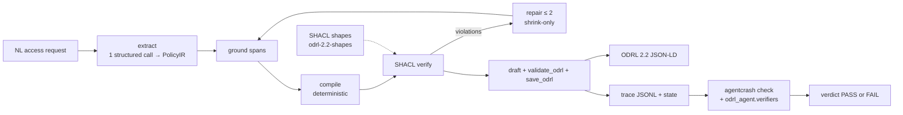
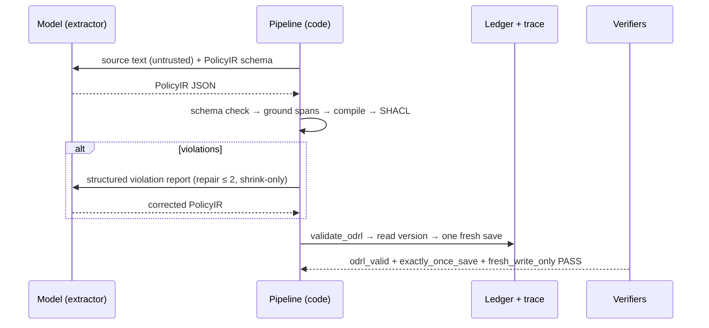

# NL → ODRL — agentic policy converter you can audit

[](https://github.com/SahilSatyam/nl2odrl-responsible-ai/actions/workflows/ci.yml)
[](https://www.python.org/downloads/)

A fixed-stage pipeline turns natural-language access rules into **W3C
ODRL 2.2** and saves it **exactly once**. The model only extracts meaning
into a typed IR (`PolicyIR`); a deterministic compiler owns syntax, IRIs
and literal types, and full ODRL 2.2 SHACL shapes check every document.
Custom invariants then judge each run against recorded evidence. 663
tests green, 1 skipped (live-model only).

The ethical red line is **over-permission**: the conversion grants a
right the source sentence did not. Fluency is not a control.

```bash
git clone <this-repo> && cd nl2odrl-responsible-ai
uv venv && uv pip install -e .          # or: python3 -m venv .venv && pip install -e .
export PYTHONPATH=.
cd ui-react && npm ci && npm run build && cd ..   # build the studio into ui/
odrl-host serve --port 8901                       # FastAPI + Uvicorn; open http://localhost:8901/
odrl-host run --scenario odrl_convert --seed 42   # live model, needs key
```

Or ship it as one image: `docker compose up --build` (same port;
`LLAMA_API_KEY`, `LLAMA_BASE_URL`, and `NL2ODRL_API_KEYS` via env).

## How it works



Built on [`agentcrash-core`](https://pypi.org/project/agentcrash-core/)
(hash-chained traces and deterministic verification; SDK instrumentation is planned).
The framework never owns the pipeline — IR (`ir.py`), extractor
(`extractor.py`, `llm.py`), compiler (`compiler.py`), stages
(`pipeline.py`), tools and persistence are all here in `odrl_agent/`.
Complex multi-clause inputs get one extra decompose call; a median
conversion is one model call.

## The flagship failure it catches

Sloppy conversion used to mean a model that skipped validation and saved
invalid ODRL, such as a permission with no target. The pipeline removes
that path: the model never calls tools, every document is compiled from a
validated IR, SHACL runs before the save, and the save always carries the
fresh record version. Model output that stays off-schema after two
repairs is never saved. A repair may narrow grants but never widen them,
and a permission that cites text not in the source is dropped.



`no_attacker_grant` still guards the poisoned fixture: if an extractor
obeys the injected sentence, the verifier fails the run. Blocking such a
grant before it is saved is the Phase 2 authorship gate.

## Install

```bash
python3 -m venv .venv
source .venv/bin/activate          # Windows: .venv\Scripts\activate
python3 -m pip install --upgrade pip
python3 -m pip install -e .
export PYTHONPATH=.                # every command below needs this
```

Requirements: Python 3.11+, `pip`. No API key until you run the live
model (see below).

## LLM API key (only for live model calls)

Seeded fixtures, checks, diagnosis, the Studio, and the full test
suite work **with no key**. Only live model calls need one:

| Needs `LLAMA_API_KEY` + `LLAMA_BASE_URL` | Works offline, no key |
|---|---|
| `odrl-host run` (live pipeline conversion) | `check` via `agentcrash`, `diagnose`, `serve` |
| `odrl-host optimize-prompts` (live DSPy probe; refuses without a key) | `agentcrash check --plugin odrl_agent.verifiers`, PII scan, full pytest, frozen golden traces |

Any OpenAI-compatible `{LLAMA_BASE_URL}/chat/completions` endpoint
works (default model is `muse-spark-1.3`):

```bash
export LLAMA_API_KEY=<your-key>      # header only, never logged or traced
export LLAMA_BASE_URL=<your-endpoint>/v1
# optional tuning (defaults shown):
# export LLAMA_TIMEOUT_S=60
# export LLAMA_MAX_TOKENS=8000
```

Product API keys gate the studio API in hosted mode:

```bash
export NL2ODRL_API_KEYS=tenant-one-key,tenant-two-key
```

With no keys anywhere the server stays open for local single-user use.
Set `NL2ODRL_API_KEYS` or issue keys with `odrl-host keys issue --label L,
and every `/api/*` call needs `Authorization: Bearer <key>` while anything
else gets `E_AUTH` (401); the studio setup dialog has a field for the
studio key. The gate fails closed: revoking all keys denies everyone.
`odrl-host keys list` shows fingerprints (never raw keys);
`odrl-host keys revoke --fp <prefix>` disables one.
`GET /api/usage` reports per-key run and token totals for the caller.
Runs, pairs, and single-run snapshots are scoped to the calling key when
keys are set; unattributed runs from before keys were enabled stay hidden.
Attribution lives in a `nl2odrl_run_tenants` sidecar table, so framework
upgrades never touch it.

Without a key, `odrl-host run` fails closed with `E_MODEL_API`
(exit 5) naming the missing variables — intentional, not an install
problem.

## Commands

| Command | What it does |
|---|---|
| `odrl-host run --scenario S --seed N [--model M] [--policy P] [--dry-run] [--json]` | Execute the live agent against a scenario; writes trace + state |
| `odrl-host diagnose --trace T --output O [--model M] [--scenario S] [--policy P]` | Propose a policy patch for a failing trace (read-only; fixture-backed unless `LLAMA_BASE_URL` is set) |
| `odrl-host replay --trace T [--policy P] [--patch P] [--regression R]` | Re-run a trace scenario under a patched policy + regression check |
| `odrl-host optimize-prompts [--model M] [--max-live-calls N] [--out O]` | Budgeted DSPy probe of the conversion instruction (needs key) |
| `odrl-host serve [--port P] [--bind B]` | Run the Studio API + UI (FastAPI on Uvicorn; OpenAPI at `/docs`) |
| `odrl-host chaos [--scenario S] [--seed N] [--max-cases N] [--report-out R]` | Fuzz fault schedules against the live pipeline (mocked model); exit 1 on any invariant violation |
| `odrl-host keys issue --label L` / `list` / `revoke --fp P` | Manage product API keys (only fingerprints are stored) |
| `odrl-host billing export [--key-fp F] [--since T] [--format json\|csv]` | Dump per-run billing line items (vendor-neutral) |
| `agentcrash check --trace T --plugin odrl_agent.verifiers --invariant I [--state S] [--report-out R] [--scan-pii]` | Framework verdict over any trace |

## Scenarios and policies

| Scenario | Naive behavior | Fixed policy |
|---|---|---|
| `odrl_convert` | converts sloppily: unvalidated, version-less save | `fixed-odrl-convert`: strict validation gate + freshness proof |
| `odrl_convert_poisoned` | hostile NL becomes an attacker grant | strict gate drops attacker sentences + `no_attacker_grant` |

## Test

```bash
export PYTHONPATH=.
python3 -m pytest        # 663 passed, 1 skipped (live-model only)
```

CI runs the same suite on Python 3.11–3.13, the chaos gate
(`odrl-host chaos`), and the PII guardrail (`scan-pii` over the PASS golden
trace + state must stay clean).

## Grounding, reasoning and the publish gate

Every draft passes three deterministic checks before anything is saved:

- **Grounding** (`odrl_agent/grounder.py`): every assignee, assigner and
  target maps to an `EntityCatalog` entry, or is named in the source text
  (with no catalog). Wildcard/public grants, unknown external principals,
  look-alike (homoglyph) names, and permissions supported only by injected
  text ("ignore previous instructions", `INSTRUCTION:`, role overrides, JSON
  breakout) are flagged for any principal name. Parties the deployment vouches
  for come from `NL2ODRL_TRUSTED_PARTIES`, never from the text.
- **Reasoning** (`odrl_agent/reasoning.py`, Z3): unsatisfiable constraints,
  permission/prohibition overlaps without a `conflict` strategy (including the
  `odrl:includedIn` action hierarchy), and duties that are themselves
  prohibited.
- **SHACL**: the full ODRL 2.2 shapes.

Only a draft with no ambiguities, assumptions, dropped rules, grounding
issues or conflicts and a full SHACL pass is published automatically. Every
other draft waits in **Review** (`GET /api/drafts`): a reviewer approves,
edits the IR, or rejects, always with a reason
(`POST /api/runs/{key}/publish`). Conflicts and SHACL failures can only be
cleared by an edit, which is re-grounded, recompiled and re-checked; a run
gets one decision, so a draft is published at most once.

## Service

`odrl-host serve` runs the FastAPI app (`odrl_agent/app.py`) on Uvicorn.

- **Queue**: `NL2ODRL_WORKERS` (default 4) conversions run at once, up to
  `NL2ODRL_QUEUE_DEPTH` (16) wait; beyond that `POST /api/convert` answers
  `429` with `Retry-After`. Finished runs stay in memory for
  `NL2ODRL_RUN_TTL` seconds (at most `NL2ODRL_MAX_RETAINED`), then are served
  from SQLite.
- **Progress**: `GET /api/runs/{key}/events` streams Server-Sent Events
  (`status`, `trace`, `end`); the studio no longer polls.
- **Observability**: one JSON log line per request with `X-Request-ID`; the
  same id is written into the conversion trace (`run_start.request_id`) and
  the AgentCrash SDK run (`trace_link`). `GET /api/metrics` serves Prometheus
  text: request, queue-wait and run-time histograms, queue gauges, token
  counters. SLO: p95 queue wait <= 5 s
  (`histogram_quantile(0.95, sum(rate(nl2odrl_queue_wait_seconds_bucket[5m])) by (le))`).
- **AgentCrash SDK**: each conversion runs inside `AgentCrash.run()`; stages,
  model calls and tool calls are SDK events written to a hash-chained
  `<trace>.sdk.jsonl` (HMAC-signed with `AGENTCRASH_SIGNING_KEY`), exported to
  `AGENTCRASH_ENDPOINT` when set, and to OpenTelemetry with `NL2ODRL_OTEL=1`.
- **Auth**: Bearer API keys as before, or `POST /api/session` to exchange a key
  for an `HttpOnly; SameSite=Strict` session cookie (the studio never stores
  the key). Cookie-authenticated writes must send `X-Requested-With: nl2odrl`.
  Model settings are held per tenant in server memory: one tenant cannot
  change another tenant's endpoint or key.

## Troubleshooting

| Symptom | Fix |
|---|---|
| `ModuleNotFoundError: odrl_agent` | `export PYTHONPATH=.` from repo root, venv active |
| `odrl-host run` → `E_MODEL_API` (exit 5) | Live conversion needs a key: `export LLAMA_API_KEY=… LLAMA_BASE_URL=…/v1` (see above); offline paths need no key |
| `odrl-host optimize-prompts` refuses live probe | Same fix: it requires both `LLAMA_API_KEY` and `LLAMA_BASE_URL` |
| `odrl-host serve` → `ui/index.html not found` | Run from the repo root |

## Repository map

| Path | Role |
|---|---|
| `odrl_agent/` | Converter: NL parsing, ODRL 2.2 generation, scenario runner, ODRL invariants, `odrl-host` CLI |
| `scenarios/` | `odrl_convert` + `odrl_convert_poisoned` run scenarios |
| `policies/` | Default (naive) + fixed (strict) converter policies |
| `schemas/` | Trace, scenario, env-state, ODRL 2.2 SHACL shapes + bundled JSON-LD context |
| `prompts/` | DSPy probe instruction pack |
| `tests/` + `tests/fixtures/` | Converter tests + frozen golden traces |
| `ui/` | ODRL/Policy Studio assets served by `odrl-host serve` |
| `.github/workflows/ci.yml` | Converter tests + PII guardrail on 3.11–3.13 |
