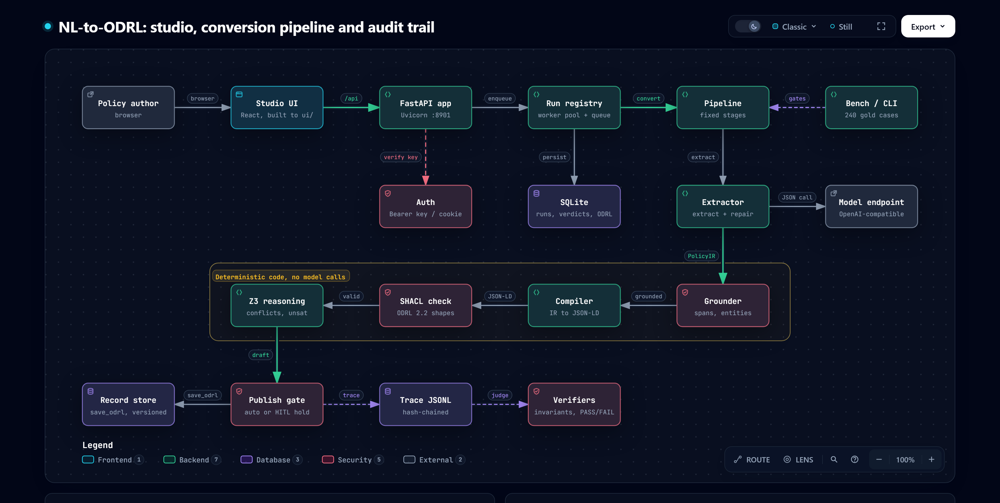
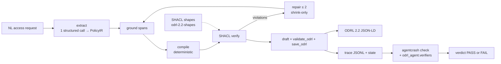
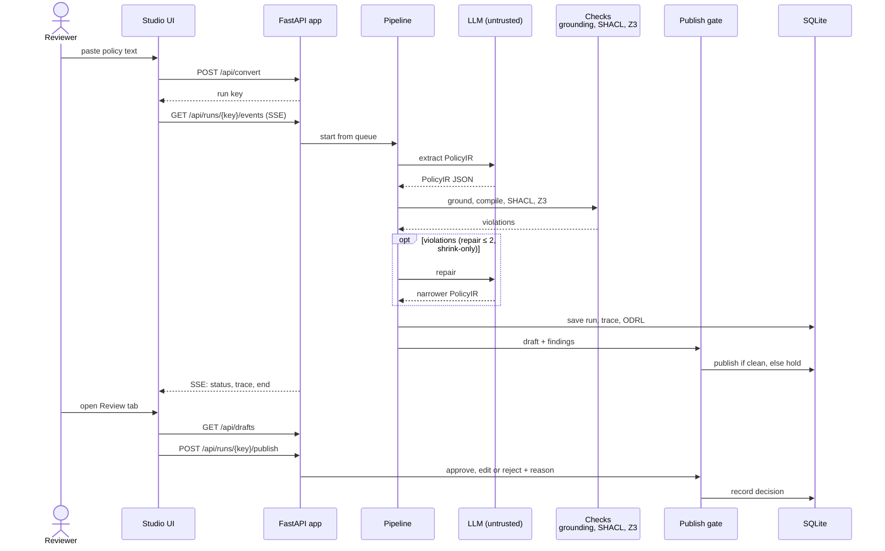
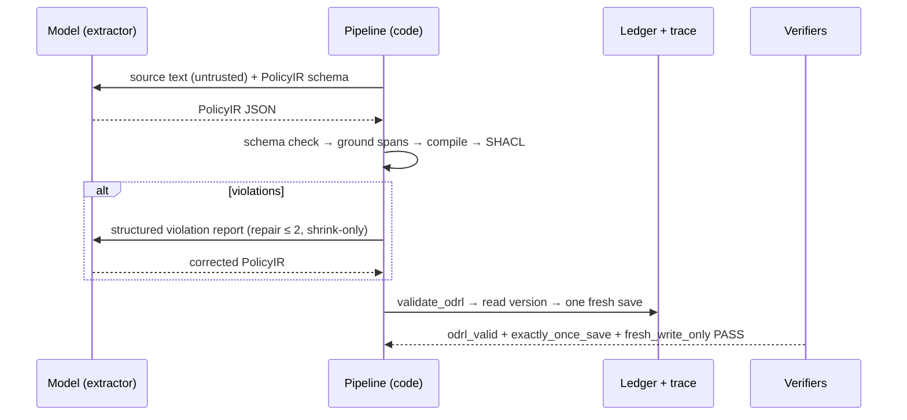

<div align="center">

# NL → ODRL

**An agentic policy converter you can audit.**
Natural-language access rules in. Verified W3C ODRL 2.2 out. Every run leaves a tamper-evident trail.

[](https://github.com/SahilSatyam/nl2odrl-responsible-ai/actions/workflows/ci.yml)
[](https://www.python.org/downloads/)
[](https://www.w3.org/TR/odrl-model/)
[](#grounding-reasoning-and-the-publish-gate)
[](#service)

[Quick start](#quick-start) · [Architecture](#architecture) · [How it works](#how-it-works) · [Safety model](#safety-model) · [Service](#service) · [CLI](#commands)

</div>

---

## Why this exists

An LLM that rewrites "Alice may read the report" into JSON-LD will sometimes grant
more than the sentence said. In access control that is the failure that matters:
**over-permission**. Fluent output is not a control.

NL → ODRL treats the model as an untrusted extractor and puts code around it:

- **The model only extracts meaning** into a typed intermediate representation (`PolicyIR`). It never calls tools and never writes ODRL.
- **A deterministic compiler** owns syntax, IRIs and literal types.
- **Three independent checks** (grounding, Z3 reasoning, full ODRL 2.2 SHACL shapes) run before anything is saved.
- **A publish gate** auto-publishes only clean drafts. Everything else waits for a human, with a reason on record.
- **Verifiers judge each run** from a hash-chained trace, not from what the agent claims it did.

A median conversion is one model call. Multi-clause inputs get one extra decompose call.

## Architecture

<a href="https://htmlpreview.github.io/?https://github.com/SahilSatyam/nl2odrl-responsible-ai/blob/develop/docs/assets/architecture-interactive.html">
  
</a>

<sub>Click the diagram for the interactive version (pan, zoom, route and lens views). The source file is
[`docs/assets/architecture-interactive.html`](docs/assets/architecture-interactive.html); open it locally if the hosted preview is unavailable.</sub>

| Layer | Components | Code |
|---|---|---|
| Studio | React UI built into `ui/`, served by the API | `ui-react/`, `ui/` |
| Service | FastAPI on Uvicorn (single-user, no login), run registry with worker pool and queue, SQLite | `odrl_agent/app.py`, `web.py`, `db.py` |
| Pipeline | Extract → ground → compile → SHACL → repair → save | `odrl_agent/pipeline.py` |
| Deterministic core | Grounder, compiler, SHACL, Z3 reasoning (no model calls) | `grounder.py`, `compiler.py`, `reasoning.py` |
| Governance | Publish gate with human-in-the-loop hold | `publish.py` |
| Audit | Hash-chained trace JSONL, verifiers with PASS/FAIL verdicts | `verifiers.py`, [`agentcrash-core`](https://pypi.org/project/agentcrash-core/) |

## Quick start

```bash
git clone https://github.com/SahilSatyam/nl2odrl-responsible-ai.git
cd nl2odrl-responsible-ai
uv venv && uv pip install -e .            # or: python -m venv .venv && pip install -e .
export PYTHONPATH=.                       # Windows: $env:PYTHONPATH="."
cd ui-react && npm ci && npm run build && cd ..   # builds the studio into ui/
odrl-host serve --port 8901               # open http://localhost:8901/
```

Or run one container: `docker compose up --build` (same port; pass `LLAMA_API_KEY`
and `LLAMA_BASE_URL` through the environment).

Requirements: Python 3.11+, Node for the studio build. **No API key is needed** for
fixtures, checks, diagnosis, the studio server or the test suite. Only live conversion needs one
(see [Model configuration](#model-configuration)).

```bash
odrl-host run --scenario odrl_convert --seed 42   # live model, needs a key
```

## How it works



The framework never owns the pipeline. The IR (`ir.py`), extractor (`extractor.py`, `llm.py`),
compiler (`compiler.py`), stages (`pipeline.py`), tools and persistence all live in `odrl_agent/`.
`agentcrash-core` supplies hash-chained traces and deterministic verification.

### One run, end to end



<sub>Interactive version: [`docs/assets/sequence-interactive.html`](https://htmlpreview.github.io/?https://github.com/SahilSatyam/nl2odrl-responsible-ai/blob/develop/docs/assets/sequence-interactive.html).</sub>

The pipeline also flags drafts for review when the source text is vague about
dates or numbers, when one clause says "always" and another "never", or when the
model dropped a grant or denial that the text states. A model reply cut off at the
token limit is retried once, then degrades to a held draft instead of an error.

## Benchmark and release gates (Phase 4)

`benchmarks/v1` holds 240 stratified cases (25/30/20/15/10 % across core
permissions, constraints/prohibitions/duties, multi-rule, ambiguous and
adversarial), each with a gold IR, grouped by source family so no group
spans the dev and test splits. `manifest.json` pins the case hash.

```bash
python -m odrl_agent.bench run                 # offline: gold-IR oracle, no model, enforces gates
python -m odrl_agent.bench run --mutant overpermit   # must exit 1: proves the gates can fail
python -m odrl_agent.bench run --mode live --workers 4 --out reports/live.json
python -m odrl_agent.bench run --mode live --freeze benchmarks/v1/baseline_v1.json
python -m odrl_agent.bench pins [--write]      # model id / prompt pack / IR schema hashes
```

Per PR the offline run checks the harness and the pipeline stages
(SHACL, grounding, reasoning, publish gate). The `bench-live` workflow
runs the real model nightly and on changes to prompts, the extractor,
the LLM client or the pins, and also blocks a false-permission-rate
increase above 0.5 points or a checkpoint-F1 drop above 0.01 against
`baseline_v1.json`. Baseline v1 is frozen with `--freeze` from a live
run; it is not committed until a maintainer has run one.

## The flagship failure it catches

- The model never calls tools. Every document is compiled from a validated IR.
- SHACL runs before the save, and the save always carries the fresh record version.
- Model output that stays off-schema after two repairs is never saved.
- A repair may narrow grants but never widen them. A permission that cites text not in the source is dropped.



`no_attacker_grant` guards the poisoned fixture: if an extractor obeys an injected sentence,
the verifier fails the run.

## Safety model

### Grounding, reasoning and the publish gate

Every draft passes three deterministic checks before anything is saved.

| Check | Module | Catches |
|---|---|---|
| **Grounding** | `odrl_agent/grounder.py` | Assignee, assigner or target not in the `EntityCatalog` (or not named in the source). Wildcard or public grants, unknown external principals, look-alike (homoglyph) names, and permissions supported only by injected text (`ignore previous instructions`, `INSTRUCTION:`, role overrides, JSON breakout). Trusted parties come from `NL2ODRL_TRUSTED_PARTIES`, never from the text. |
| **Reasoning** (Z3) | `odrl_agent/reasoning.py` | Unsatisfiable constraints, permission/prohibition overlaps without a `conflict` strategy (including the `odrl:includedIn` action hierarchy), and duties that are themselves prohibited. |
| **SHACL** | `schemas/` | The full ODRL 2.2 shapes. |

Only a draft with no ambiguities, assumptions, dropped rules, grounding issues or conflicts, and a
full SHACL pass, is published automatically. Every other draft waits in **Review**
(`GET /api/drafts`). A reviewer approves, edits the IR, or rejects, always with a reason
(`POST /api/runs/{key}/publish`). Conflicts and SHACL failures clear only through an edit, which is
re-grounded, recompiled and re-checked. A run gets one decision, so a draft is published at most once.

### Scenarios

| Scenario | Naive behavior | Fixed policy |
|---|---|---|
| `odrl_convert` | Converts sloppily: unvalidated, version-less save | `fixed-odrl-convert`: strict validation gate and freshness proof |
| `odrl_convert_poisoned` | Hostile NL becomes an attacker grant | Strict gate drops attacker sentences, plus `no_attacker_grant` |

## Model configuration

Any OpenAI-compatible `{LLAMA_BASE_URL}/chat/completions` endpoint works (default model `muse-spark-1.3`).

```bash
export LLAMA_API_KEY=<your-key>        # sent as a header, never logged or traced
export LLAMA_BASE_URL=<your-endpoint>/v1
# optional (defaults shown):
# export LLAMA_TIMEOUT_S=60
# export LLAMA_MAX_TOKENS=8000
```

| Needs `LLAMA_API_KEY` + `LLAMA_BASE_URL` | Works offline, no key |
|---|---|
| `odrl-host run` (live conversion) | `agentcrash check`, `diagnose`, `serve` |
| `odrl-host optimize-prompts` (live DSPy probe; refuses without a key) | PII scan, full pytest, frozen golden traces |

Without a key, `odrl-host run` fails closed with `E_MODEL_API` (exit 5) and names the missing variables.

## Service

`odrl-host serve` runs the FastAPI app (`odrl_agent/app.py`) on Uvicorn. OpenAPI is at `/docs`.

- **Queue**: `NL2ODRL_WORKERS` (default 4) conversions run at once and up to `NL2ODRL_QUEUE_DEPTH` (16) wait. Beyond that, `POST /api/convert` answers `429` with `Retry-After`. Finished runs stay in memory for `NL2ODRL_RUN_TTL` seconds (at most `NL2ODRL_MAX_RETAINED`), then are served from SQLite.
- **Progress**: `GET /api/runs/{key}/events` streams Server-Sent Events (`status`, `trace`, `end`).
- **Observability**: one JSON log line per request with `X-Request-ID`. The same id is written into the conversion trace (`run_start.request_id`) and the AgentCrash SDK run (`trace_link`). `GET /api/metrics` serves Prometheus text with request, queue-wait and run-time histograms, queue gauges and token counters. SLO: p95 queue wait ≤ 5 s.
  `histogram_quantile(0.95, sum(rate(nl2odrl_queue_wait_seconds_bucket[5m])) by (le))`
- **AgentCrash SDK**: each conversion runs inside `AgentCrash.run()`. Stages, model calls and tool calls are SDK events written to a hash-chained `<trace>.sdk.jsonl` (HMAC-signed with `AGENTCRASH_SIGNING_KEY`), exported to `AGENTCRASH_ENDPOINT` when set, and to OpenTelemetry with `NL2ODRL_OTEL=1`.

### Local server (no accounts, no keys)

The server is a single-user local process: every `/api/*` route is open and
needs no login. `GET /api/usage` reports local run and token totals.
Model settings are held in server memory via `POST /api/settings`
(the key is never echoed, logged, or traced).

## Commands

| Command | What it does |
|---|---|
| `odrl-host run --scenario S --seed N [--model M] [--policy P] [--dry-run] [--json]` | Execute the live agent against a scenario; writes trace and state |
| `odrl-host diagnose --trace T --output O [--model M] [--scenario S] [--policy P]` | Propose a policy patch for a failing trace (read-only; fixture-backed unless `LLAMA_BASE_URL` is set) |
| `odrl-host replay --trace T [--policy P] [--patch P] [--regression R]` | Re-run a trace scenario under a patched policy, plus a regression check |
| `odrl-host optimize-prompts [--model M] [--max-live-calls N] [--out O]` | Budgeted DSPy probe of the conversion instruction (needs a key) |
| `odrl-host serve [--port P] [--bind B]` | Run the Studio API and UI |
| `odrl-host chaos [--scenario S] [--seed N] [--max-cases N] [--report-out R]` | Fuzz fault schedules against the live pipeline (mocked model); exit 1 on any invariant violation |
| `agentcrash check --trace T --plugin odrl_agent.verifiers --invariant I [--state S] [--report-out R] [--scan-pii]` | Framework verdict over any trace |

## Test

```bash
export PYTHONPATH=.
python -m pytest        # live-model tests are skipped without a key
```

CI runs the suite on Python 3.11 to 3.13, the chaos gate (`odrl-host chaos`), and the PII guardrail
(`scan-pii` over the PASS golden trace and state must stay clean).

## Troubleshooting

| Symptom | Fix |
|---|---|
| `ModuleNotFoundError: odrl_agent` | Set `PYTHONPATH=.` from the repo root with the venv active |
| `odrl-host run` → `E_MODEL_API` (exit 5) | Live conversion needs a key. Set `LLAMA_API_KEY` and `LLAMA_BASE_URL` (see [Model configuration](#model-configuration)) |
| `odrl-host optimize-prompts` refuses the live probe | It requires both `LLAMA_API_KEY` and `LLAMA_BASE_URL` |
| `odrl-host serve` → `ui/index.html not found` | Run from the repo root, after building the studio |

## Repository map

| Path | Role |
|---|---|
| `odrl_agent/` | Converter: IR, extractor, compiler, grounder, reasoning, pipeline, publish gate, FastAPI app, verifiers, `odrl-host` CLI |
| `ui-react/` | Studio source (React); builds into `ui/` |
| `ui/` | Built studio assets served by `odrl-host serve` |
| `scenarios/` | `odrl_convert` and `odrl_convert_poisoned` run scenarios |
| `policies/` | Default (naive) and fixed (strict) converter policies |
| `schemas/` | Trace, scenario and env-state schemas, ODRL 2.2 SHACL shapes, bundled JSON-LD context |
| `benchmarks/` | Baseline cases and results, smoke set |
| `prompts/` | DSPy probe instruction pack |
| `tests/`, `tests/fixtures/` | Test suite and frozen golden traces |
| `docs/` | Implementation plan and architecture diagram assets |
| `.github/workflows/ci.yml` | Tests, chaos gate and PII guardrail on Python 3.11 to 3.13 |
