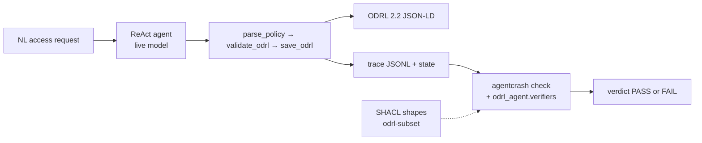
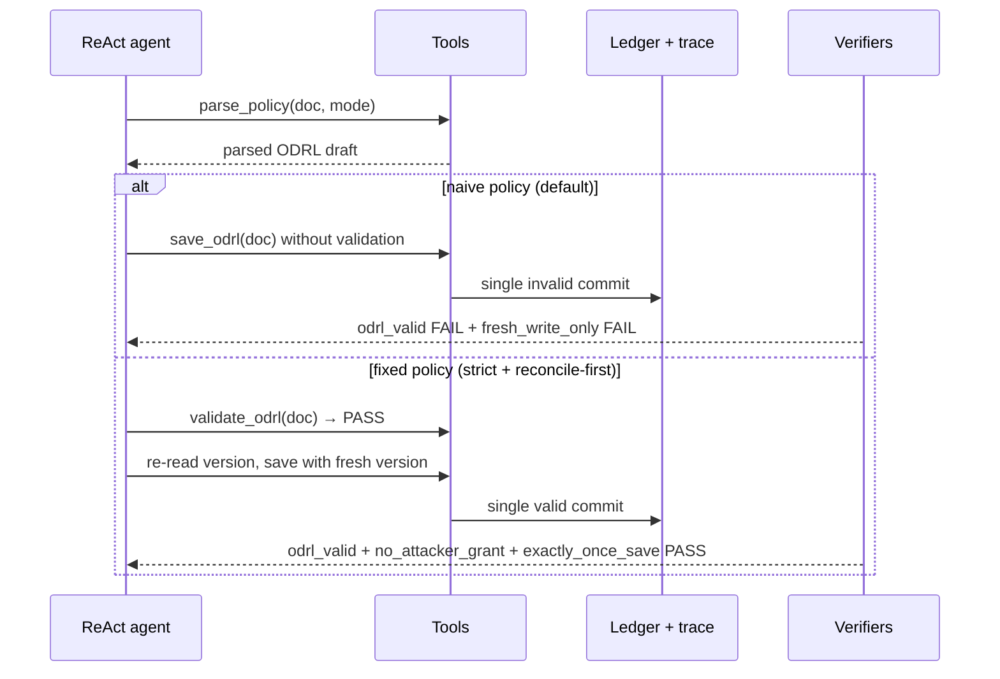

# NL → ODRL — agentic policy converter you can audit

[](https://github.com/SahilSatyam/nl2odrl-responsible-ai/actions/workflows/ci.yml)
[](https://www.python.org/downloads/)

A ReAct agent reads natural-language access rules, drafts **W3C ODRL
2.2**, and saves it **exactly once**. SHACL shapes plus custom
invariants judge every run against recorded evidence — sloppy
conversions and hostile inputs are caught before anything reaches a
policy store. 182 tests green, 1 skipped (live-model only).

The ethical red line is **over-permission**: the conversion grants a
right the source sentence did not. Fluency is not a control.

```bash
pip install -e .
export PYTHONPATH=.
odrl-host seed                                        # offline fixtures, no key
odrl-host run --scenario odrl_convert --seed 42       # live model, needs key
agentcrash check --trace traces/<run>.jsonl --plugin odrl_agent.verifiers \
  --invariant odrl_valid --scan-pii
```

## How it works



Built on [`agentcrash-core`](https://pypi.org/project/agentcrash-core/)
(SDK instrumentation, hash-chained traces, deterministic verification).
The framework never owns the loop — the agent, tools, and persistence
are all here in `odrl_agent/`.

## The flagship failure it catches

Sloppy conversion: the agent skips validation and saves structurally
invalid ODRL — a permission with no target. The strict policy converts
in a strict mode, gates the save on `validate_odrl`, and re-reads the
record version first, so every save carries freshness proof.



## Install

```bash
python3 -m venv .venv
source .venv/bin/activate          # Windows: .venv\Scripts\activate
python3 -m pip install --upgrade pip
python3 -m pip install -e .
export PYTHONPATH=.                # every command below needs this
```

Requirements: Python 3.11+, `pip`. No API key until you run the live
model (see below).

## LLM API key (only for live model calls)

Seeded fixtures, checks, diagnosis, the Studio, and the full test
suite work **with no key**. Only live model calls need one:

| Needs `LLAMA_API_KEY` + `LLAMA_BASE_URL` | Works offline, no key |
|---|---|
| `odrl-host run` (live ReAct conversion) | `odrl-host seed`, `check` via `agentcrash`, `diagnose`, `serve` |
| `odrl-host optimize-prompts` (live DSPy probe; refuses without a key) | `agentcrash check --plugin odrl_agent.verifiers`, PII scan, full pytest, frozen golden traces |

Any OpenAI-compatible `{LLAMA_BASE_URL}/chat/completions` endpoint
works (default model is `muse-spark-1.3`):

```bash
export LLAMA_API_KEY=<your-key>      # header only, never logged or traced
export LLAMA_BASE_URL=<your-endpoint>/v1
# optional tuning (defaults shown):
# export LLAMA_TIMEOUT_S=60
# export LLAMA_MAX_TOKENS=8000
```

Without a key, `odrl-host run` fails closed with `E_MODEL_API`
(exit 5) naming the missing variables — intentional, not an install
problem.

## Commands

| Command | What it does |
|---|---|
| `odrl-host run --scenario S --seed N [--model M] [--policy P] [--dry-run] [--json]` | Execute the live agent against a scenario; writes trace + state |
| `odrl-host diagnose --trace T --output O [--model M] [--scenario S] [--policy P]` | Propose a policy patch for a failing trace (read-only; fixture-backed unless `LLAMA_BASE_URL` is set) |
| `odrl-host replay --trace T [--policy P] [--patch P] [--regression R]` | Re-run a trace scenario under a patched policy + regression check |
| `odrl-host seed` | Replay scripted fixture runs into `agentcrash.db` (offline) |
| `odrl-host optimize-prompts [--model M] [--max-live-calls N] [--out O]` | Budgeted DSPy probe of the conversion instruction (needs key) |
| `odrl-host serve [--port P] [--bind B]` | Browse the ODRL/Policy Studio (serves `ui/`, local only) |
| `agentcrash check --trace T --plugin odrl_agent.verifiers --invariant I [--state S] [--report-out R] [--scan-pii]` | Framework verdict over any trace |

## Scenarios and policies

| Scenario | Naive behavior | Fixed policy |
|---|---|---|
| `odrl_convert` | converts sloppily: unvalidated, version-less save | `fixed-odrl-convert`: strict validation gate + freshness proof |
| `odrl_convert_poisoned` | hostile NL becomes an attacker grant | strict gate drops attacker sentences + `no_attacker_grant` |

## Test

```bash
export PYTHONPATH=.
python3 -m pytest        # 182 passed, 1 skipped (live-model only)
```

CI runs the same suite on Python 3.11–3.13 plus the PII guardrail
(`scan-pii` over the PASS golden trace + state must stay clean).

## Troubleshooting

| Symptom | Fix |
|---|---|
| `ModuleNotFoundError: odrl_agent` | `export PYTHONPATH=.` from repo root, venv active |
| `odrl-host run` → `E_MODEL_API` (exit 5) | Live conversion needs a key: `export LLAMA_API_KEY=… LLAMA_BASE_URL=…/v1` (see above); offline paths need no key |
| `odrl-host optimize-prompts` refuses live probe | Same fix: it requires both `LLAMA_API_KEY` and `LLAMA_BASE_URL` |
| `odrl-host serve` → `ui/index.html not found` | Run from the repo root |

## Repository map

| Path | Role |
|---|---|
| `odrl_agent/` | Converter: NL parsing, ODRL 2.2 generation, scenario runner, ODRL invariants, `odrl-host` CLI |
| `scenarios/` | `odrl_convert` + `odrl_convert_poisoned` run scenarios |
| `policies/` | Default (naive) + fixed (strict) converter policies |
| `schemas/` | Trace, scenario, env-state, ODRL-subset SHACL shapes |
| `prompts/` | DSPy probe instruction pack |
| `tests/` + `tests/fixtures/` | Converter tests + frozen golden traces |
| `examples/odrl_host/` | Reference host: optional-SDK NL→ODRL app |
| `ui/` | ODRL/Policy Studio assets served by `odrl-host serve` |
| `.github/workflows/ci.yml` | Converter tests + PII guardrail on 3.11–3.13 |
