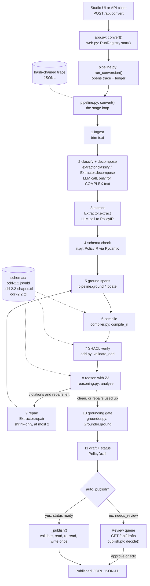

# From English to ODRL: a walkthrough of the NL → ODRL pipeline

This guide follows one complex policy sentence through the codebase, from the text a user types to the ODRL document that comes out. It assumes you have never heard of ODRL and have not read this repository.

- [1. What this project does](#1-what-this-project-does)
- [2. The big picture](#2-the-big-picture)
- [3. The running example](#3-the-running-example)
- [4. Stage-by-stage walkthrough](#4-stage-by-stage-walkthrough)
- [5. Final ODRL output](#5-final-odrl-output)
- [6. What the codebase does not support](#6-what-the-codebase-does-not-support)
- [7. Glossary](#7-glossary)

> **How the examples in this guide were produced.** No live model was called. The model replies are scripted stand-ins that a good model would plausibly return, because a real model's wording changes from run to run. Everything after the model call is the repository's real code, run through `odrl_agent.pipeline.convert`. Every "Output" block below is real program output. To reproduce it yourself:
>
> ```powershell
> $env:PYTHONPATH=".;tests"; python docs/examples/walkthrough_demo.py      # bash: PYTHONPATH=.:tests python ...
> ```
>
> The script is [`docs/examples/walkthrough_demo.py`](examples/walkthrough_demo.py). It needs no API key.

---

## 1. What this project does

**The problem.** Organizations write rules about data in plain language: "The university may read this dataset in Europe until the end of 2026." Computers cannot enforce a sentence. They need a precise, structured format.

**ODRL** (Open Digital Rights Language) is a W3C standard format for exactly that. An ODRL document says *who* may or must or must not do *what* to *which thing*, under *which conditions*. It is usually written as JSON-LD (a JSON dialect that gives every word a globally unique meaning, explained in the glossary).

**This project** converts the English sentence into an ODRL document. A language model (an LLM) reads the English, but it is treated as an untrusted helper. It never writes ODRL. It only fills in a small, strictly typed form. Ordinary code then does the rest: it checks the form, compiles it to ODRL, validates the result, and decides whether the result is safe to publish or needs a human to look at it.

The reason for this design: an LLM that writes ODRL directly sometimes grants *more* access than the sentence said. In access control, granting too much is the failure that matters.

### The ODRL building blocks you will meet

| ODRL part | Plain meaning | Example in this guide |
|---|---|---|
| **Policy** (`Set`, `Offer`, `Agreement`) | The whole document. The type says how many parties are named and whether the policy is a proposal or a deal | `Agreement` |
| **Asset** (`target`) | The thing the rules are about | the 2026 Healthcare Analytics Dataset |
| **Party** (`assigner`, `assignee`) | Who grants the rules (assigner) and who receives them (assignee) | Acme Data Corp, University Research Labs |
| **Permission** | Something the assignee *may* do | read, derive (analyze) |
| **Action** | The verb inside a rule | `read`, `derive`, `distribute` |
| **Constraint** | A condition that limits when or where a rule applies | in the EU, until 2026-12-31 |
| **Duty** | Something the assignee *must* do in return for a permission | attribute, delete copies |
| **Prohibition** | Something the assignee *must not* do | distribute, use commercially |

---

## 2. The big picture



Two rules shape the whole diagram:

1. **The model is called in only three places:** decompose, extract and repair. Every other box is plain deterministic code, with no model and no network.
2. **Nothing is published unless every check is clean.** Any doubt sends the draft to a human.

### Where the files live

| Concern | File |
|---|---|
| HTTP entry | `odrl_agent/app.py` (`POST /api/convert`), `odrl_agent/web.py` (`RunRegistry`, `build_inline_run`) |
| Stage orchestration | `odrl_agent/pipeline.py` (`run_conversion`, `convert`) |
| Model prompts and calls | `odrl_agent/extractor.py` (`Extractor`), `odrl_agent/llm.py` (`StructuredLlm`) |
| The typed form | `odrl_agent/ir.py` (`PolicyIR`) |
| Entity checks | `odrl_agent/grounder.py` (`Grounder`) |
| IR to ODRL | `odrl_agent/compiler.py` (`compile_ir`) |
| Validation | `odrl_agent/odrl.py` (`validate_odrl`) |
| Logic checks | `odrl_agent/reasoning.py` (`analyze`) |
| Human review | `odrl_agent/publish.py` (`decide`, `review_draft`) |
| ODRL vocabulary and rules | `schemas/odrl-2.2.jsonld`, `schemas/odrl-2.2-shapes.ttl`, `schemas/odrl-2.2.ttl` |

---

## 3. The running example

This is the input, character for character (362 characters, two sentences):

> *Acme Data Corp permits University Research Labs to read and analyze the 2026 Healthcare Analytics Dataset strictly within the European Union until December 31, 2026, provided they attribute Acme Data Corp in any published results and delete all local copies after expiration. Redistributing the dataset or using it for commercial purposes is strictly prohibited.*

Here is how its phrases map to ODRL parts, before any code touches them:

| Phrase | ODRL part |
|---|---|
| "Acme Data Corp permits … " | Policy type, `assigner` |
| "University Research Labs" | `assignee` |
| "the 2026 Healthcare Analytics Dataset" | `target` (asset) |
| "read and analyze" | two permissions (`read`, plus an action for "analyze") |
| "within the European Union" | spatial constraint |
| "until December 31, 2026" | temporal constraint |
| "attribute Acme Data Corp … and delete all local copies after expiration" | two duties |
| "Redistributing … or using it for commercial purposes is … prohibited" | two prohibitions |

Two of those phrases do not fit ODRL cleanly, and one combination triggers a conflict check. The walkthrough points each out where it happens, and [section 6](#6-what-the-codebase-does-not-support) collects them.

---

## 4. Stage-by-stage walkthrough

### Stage 0: The request arrives

**Where it lives:** `odrl_agent/app.py` → `convert()`; `odrl_agent/web.py` → `validate_convert()`, `RunRegistry.start()`, `build_inline_run()`; `odrl_agent/pipeline.py` → `run_conversion()`.

**What it does:** The Studio UI (or any HTTP client) posts the text to `POST /api/convert`. The server checks the request body, then puts the job in a queue with a limited number of workers. `build_inline_run` wraps your pasted text as the single "document" of a built-in scenario. `run_conversion` then opens a **trace** (an append-only log in which each entry carries the hash of the previous one, so tampering is detectable) and a small in-memory **ledger** that stands in for the store where a published policy is saved. Then it calls `convert()`, which holds the stage loop.

```python
# odrl_agent/app.py (abridged)
@app.post("/api/convert")
async def convert(request: Request) -> Any:
    body = await json_body(request)
    nl_text, variant, seed, max_steps = web.validate_convert(body)   # reject bad input early
    return await run_in_threadpool(app.state.registry.start, nl_text, ...)  # queue the job
```

**Input:** `{"nl_text": "Acme Data Corp permits University Research Labs ..."}`. `validate_convert` also accepts optional `policy_variant`, `seed` and `max_steps`, and rejects empty text.
**Output:** a run key, and a background job that will call `pipeline.convert(text, ...)`.

---

### Stage 1: Ingest

**Where it lives:** `pipeline.convert()`, first lines.

**What it does:** Trims whitespace. Empty text stops the run with status `failed`.

```python
source = text.strip()
stage("ingest", chars=len(source), **(source_meta or {}))   # write a trace entry
if not source:                                              # nothing to convert
    draft = PolicyDraft("failed", None, None, False, ["empty input"], [], [])
```

**Input:** the 362-character text. **Output:** the same text, and the trace entry `ingest {"chars": 362}`.

---

### Stage 2: Classify, then decompose

**Where it lives:** `odrl_agent/extractor.py` → `classify()`, `split_sentences()`, `Extractor.decompose()`.

**What it does:** Decides whether the text is simple or complex using a plain regular expression and a sentence count. No model is involved in that decision. Complex text gets one extra, cheap model call that splits it into **clause groups**, one per independent rule, which makes the next step more accurate.

```python
# Words that usually mean the text carries more than one rule or an exception.
_COMPLEX_MARKERS = re.compile(
    r"\b(unless|except|provided that|but|however|...|must not|may not|prohibited|forbidden|...)\b",
    re.IGNORECASE)

def classify(text: str) -> str:
    sentences = split_sentences(text)
    markers = len(_COMPLEX_MARKERS.findall(text))
    # 4+ sentences, or 2+ markers, or (2+ sentences and 1+ marker) -> COMPLEX
    if len(sentences) >= 4 or markers >= 2 or (len(sentences) >= 2 and markers >= 1):
        return "COMPLEX"
    ...
```

Our text has two sentences and one marker. "provided that" does not match (the text says "provided they"), but "prohibited" does. Two or more sentences plus one marker is enough, so the real run printed `COMPLEX` and the decompose call happens. `Extractor.decompose` asks the model for `{"clauses": [...]}`, then **discards any clause that is not an exact substring of the source**. A model cannot invent text this way. If the reply is malformed it falls back to the plain sentence splitter.

**Input:** the 362-character text.
**Output:**

```json
{"clauses": [
  "Acme Data Corp permits University Research Labs to read and analyze the 2026 Healthcare Analytics Dataset strictly within the European Union until December 31, 2026, provided they attribute Acme Data Corp in any published results and delete all local copies after expiration.",
  "Redistributing the dataset or using it for commercial purposes is strictly prohibited."
]}
```

Trace entry: `decompose {"route": "COMPLEX", "clauses": 2}`.

---

### Stage 3: Extract (the model fills in the typed form)

**Where it lives:** `Extractor.extract()` and `SYSTEM_PROMPT` in `odrl_agent/extractor.py`; `StructuredLlm.complete_json()` in `odrl_agent/llm.py`; the form itself is `PolicyIR` in `odrl_agent/ir.py`.

**What it does:** Makes **one** model call. The model receives:

- a system prompt of rules (use only listed actions, copy quotes verbatim, never invent a party or date, map "until a date" to a fixed constraint shape, one action per rule, denials become their own prohibition rules);
- the source text wrapped in `<untrusted_source>` tags, so the model treats it as data and not as instructions;
- the clause groups from Stage 2;
- a JSON Schema of `PolicyIR`, sent as `response_format`, which forces the reply to be a JSON object of that shape.

```python
# odrl_agent/extractor.py
def _source_block(text, clauses):
    body = f'<untrusted_source>\n{text}\n</untrusted_source>'   # model must treat this as data
    ...

# odrl_agent/llm.py
body = {"model": model, "messages": messages,
        "temperature": 0,                                       # most repeatable output
        "response_format": {"type": "json_schema",
                            "json_schema": {"name": schema_name, "schema": schema, "strict": False}}}
```

**What is the "IR"?** `PolicyIR` (IR means *intermediate representation*) is a small Pydantic model, a Python class that validates data when you create it. It is flat and simple on purpose, so a model can fill it in reliably. It is *not* ODRL. It has no IRIs, no JSON-LD syntax and no `@context`. The pieces that matter for our example:

```python
class PolicyIR(_Model):
    policy_type: Literal["Set", "Offer", "Agreement"] = "Set"
    conflict_strategy: Literal["perm", "prohibit", "invalid"] | None = None
    assigner: str | None = None
    assignee: str | None = None
    rules: list[RuleIR] = []
    ambiguities: list[AmbiguityFlag] = []     # "the text leaves this open"
    assumptions: list[AssumptionRecord] = []  # "I had to fill in this value"

class RuleIR(_Model):
    modality: Literal["permission", "prohibition", "obligation"]
    action: Action            # a Literal of the 41 ODRL 2.2 action names
    target: str | None
    constraints: list[ConstraintNode] = []
    duties: list[DutyIR] = []                 # only a permission may carry duties
    source_spans: list[SpanRef] = []          # verbatim quotes that justify the rule

class ConstraintIR(_Model):
    left_operand: LeftOperand   # what is measured: spatial, dateTime, purpose, count ...
    operator: Operator          # eq, lteq, gt, isAnyOf ...
    right_operand: str          # the value, as text
    value_type: ValueType       # string, date, dateTime, integer, duration ...
```

**Input** (what the model sees, abridged):

```text
system:  You convert natural-language access rules into a typed policy IR. ... Actions: use, grantUse, ... 
user:    <untrusted_source> Acme Data Corp permits University Research Labs ... </untrusted_source>
         Clause groups (one or more rules each):
         1. Acme Data Corp permits ... after expiration.
         2. Redistributing the dataset or using it for commercial purposes is strictly prohibited.
```

**Output** (the model's reply, abridged; the scripted stand-in in `walkthrough_demo.py`):

```json
{
  "analysis": "Acme grants read and derive access with EU and date limits, two duties and two denials.",
  "policy_type": "Agreement",
  "assigner": "Acme Data Corp",
  "assignee": "University Research Labs",
  "rules": [
    { "modality": "permission", "action": "read",   "target": "2026 Healthcare Analytics Dataset",
      "constraints": [
        {"kind":"atomic","left_operand":"spatial","operator":"eq","right_operand":"European Union","value_type":"string"},
        {"kind":"atomic","left_operand":"dateTime","operator":"lteq","right_operand":"2026-12-31","value_type":"date"}],
      "duties": [
        {"action":"attribute","target":"2026 Healthcare Analytics Dataset"},
        {"action":"delete","target":"2026 Healthcare Analytics Dataset",
         "constraints":[{"kind":"atomic","left_operand":"dateTime","operator":"gt","right_operand":"2026-12-31","value_type":"date"}]}],
      "source_spans": [{"quote": "Acme Data Corp permits ... after expiration."}] },
    { "modality": "permission", "action": "derive", "...": "same target, constraints and duties as rule 0" },
    { "modality": "prohibition", "action": "distribute", "target": "2026 Healthcare Analytics Dataset",
      "source_spans": [{"quote": "Redistributing the dataset or using it ... prohibited."}] },
    { "modality": "prohibition", "action": "use", "target": "2026 Healthcare Analytics Dataset",
      "constraints": [{"kind":"atomic","left_operand":"purpose","operator":"eq","right_operand":"commercial","value_type":"string"}],
      "source_spans": [{"quote": "Redistributing the dataset or using it ... prohibited."}] }
  ],
  "ambiguities": [{"kind": "other", "description": "attribution of Acme Data Corp in published results has no ODRL left operand; only the attribute action is recorded"}],
  "assumptions": [{"field": "rules.1.action", "assumed_value": "derive", "reason": "ODRL 2.2 has no 'analyze' action"}]
}
```

How each ODRL part appears in this reply:

| ODRL part | How the IR represents it |
|---|---|
| Policy type | `"policy_type": "Agreement"`. The default is `Set`. Choosing `Agreement` (both parties named) over `Offer` is the model's judgment. Code only enforces the minimum: `PolicyIR._check` requires an assigner for `Offer`/`Agreement` and an assignee for `Agreement` |
| Asset | `target` on each rule |
| Parties | `assigner`, `assignee` at policy level |
| Permissions and actions | one rule per action: "read **and** analyze" becomes two rules, because the prompt says "one action, one rule" |
| Constraints | `ConstraintIR` entries, using the fixed shapes in the prompt: "within \<place\>" is `(spatial, eq, place, string)` and "until \<date\>" is `(dateTime, lteq, date, date)` |
| Duties | `DutyIR` entries inside `duties` of a permission. "after expiration" becomes `dateTime gt 2026-12-31` |
| Prohibitions | `modality: "prohibition"` rules. "Commercial use" is `use` narrowed by `purpose eq commercial` |

Note the **assumption** and the **ambiguity**. The vocabulary has no "analyze" action, so the model picked `derive` and was required to say so. Neither entry stops the run. Both force a human review at the end.

---

### Stage 4: Schema check (reject anything off-vocabulary)

**Where it lives:** `extractor.parse_ir()` calls `PolicyIR.model_validate(raw)`; the rules are in `odrl_agent/ir.py`.

**What it does:** Pydantic checks the reply. An action not in the 41-name list, an unknown operand, a date that is not a real date, a duty on a prohibition, an `Agreement` with no assignee: each is rejected here, before any ODRL exists.

```python
class ConstraintIR(_Model):
    @model_validator(mode="after")
    def _check(self) -> ConstraintIR:
        problem = check_value(self.value_type, self.right_operand)   # "2026-12-31" must parse as a date
        if problem:
            raise ValueError(f"right_operand {self.right_operand!r} invalid as {self.value_type}: {problem}")
        allowed = OPERAND_VALUE_TYPES.get(self.left_operand)         # dateTime takes only date/dateTime
        if allowed and self.value_type not in allowed:
            raise ValueError(...)
```

This is why "analyze" had to become something else. `Action` is a closed `Literal` type, and `"analyze"` is not in it. A model reply that said `"action": "analyze"` would fail validation and go to the repair loop.

**Input:** the raw JSON above. **Output:** a validated `PolicyIR` object, or a list of strings like `rules.1.action: Input should be 'use', 'grantUse', ...`. The demo prints `extract {"schema_errors": [], "rules": 4}`.

---

### Stage 5: Ground (prove the quotes and names are real)

**Where it lives:** `pipeline.ground()` and `pipeline.locate()` (quote offsets); `Grounder.ground()` in `odrl_agent/grounder.py` (names and least privilege).

**What it does:** Two separate checks that stop the model from inventing things.

*5a, span grounding.* Each rule must cite at least one verbatim quote. `locate()` finds it in the source and records character offsets. A quote that is not in the source is a violation, and a *permission* with no real quote is dropped later.

```python
def locate(quote, source):
    start = source.find(quote)                       # exact match first
    if start >= 0:
        return start, start + len(quote)
    ...                                              # then case/whitespace-insensitive
```

*5b, entity grounding.* `Grounder.ground()` checks each party and asset. With no entity catalog configured (the default in `run_conversion`), a name must appear in the source text. It also rejects wildcard grants ("anyone", "public"), look-alike names that mix alphabets (for example a Cyrillic "а" inside a Latin word), and permissions supported only by text that reads like a prompt injection ("ignore previous instructions"). All of it is deterministic code.

```python
# Grounder._resolve (abridged)
if kind == "party" and is_grant and normalize_name(name) in WILDCARD_NAMES:
    issue(BROAD_GRANT, f"grant to wildcard/public principal {name!r}")
...
mentions = [m for alias in _aliases(name) for m in _mentions(alias, source)]
if not mentions:
    issue(code, f"{name!r} does not appear in the source text")     # UNGROUNDED_PRINCIPAL / _TARGET
```

**Input:** the validated IR plus the source text.
**Output:** the same IR with offsets filled in, and an empty problem list:

```json
"source_spans": [{"quote": "Acme Data Corp permits ... after expiration.", "start": 0,   "end": 275}]   // rules 0 and 1
"source_spans": [{"quote": "Redistributing the dataset ... is strictly prohibited.", "start": 276, "end": 362}] // rules 2 and 3
```

Trace entry: `ground {"violations": []}`. All three names ("Acme Data Corp", "University Research Labs", "2026 Healthcare Analytics Dataset") occur in the text, so the grounding report is `{"grounded": true, "issues": []}`. Note that the prohibitions say "the dataset" while the IR uses the full asset name. That is fine, because the full name does occur in sentence 1.

---

### Stage 6: Compile (IR to ODRL JSON-LD)

**Where it lives:** `odrl_agent/compiler.py` → `compile_ir()`, `compile_doc()`, `_rule()`, `_duty()`, `_constraint()`, `_literal()`, `mint_iri()`.

**What it does:** Turns the IR into a real ODRL JSON-LD document. It is plain Python with no model, no network and no clock, so the same IR always gives the same bytes. This is where the IR vocabulary is mapped to the ODRL vocabulary.

**Names become IRIs.** An IRI is a globally unique identifier, like a URL that does not have to be fetchable. The compiler mints stable `urn:` identifiers from the names:

```python
PARTY_PREFIX = "urn:nl2odrl:party:"
ASSET_PREFIX = "urn:nl2odrl:asset:"

def mint_iri(name, prefix):
    text = name.strip()
    if _ABSOLUTE_IRI.match(text):          # already urn:/http(s):/did:/tag: -> keep it
        return text
    slug = re.sub(r"\s+", "-", text.casefold())      # "Acme Data Corp" -> "acme-data-corp"
    return prefix + quote(slug, safe="-._~")
```

**Constraints and values become typed.**

```python
def _literal(value_type, raw):
    if value_type == "string":
        return raw                                         # "European Union"
    if value_type == "iri":
        return {"@id": raw}
    return {"@value": raw, "@type": XSD + value_type}      # {"@value":"2026-12-31","@type":"...#date"}

def _constraint(node):
    ...
    return {"type": "Constraint", "leftOperand": node.left_operand,
            "operator": node.operator, "rightOperand": _literal(node.value_type, node.right_operand)}
```

**Rules are built by modality, and shared fields are hoisted.** A party that appears at policy level is not repeated inside each rule:

```python
def _rule(rule, index, policy):
    ...
    out = {"type": "Permission" if rule.modality == "permission" else "Prohibition",
           "action": _action(rule)}
    if rule.target:
        out["target"] = mint_iri(rule.target, ASSET_PREFIX)
    if rule.assignee and (rule.modality == "obligation" or rule.assignee != policy.assignee):
        out["assignee"] = mint_iri(rule.assignee, PARTY_PREFIX)   # skipped here: same as policy assignee
    if rule.constraints:
        out["constraint"] = [_constraint(node) for node in rule.constraints]
    if rule.duties:
        out["duty"] = [_duty(duty) for duty in rule.duties]
    return out
```

Top-level assembly in `compile_doc` then groups rules under `permission`, `prohibition` and `obligation` keys, adds `"@context": "http://www.w3.org/ns/odrl.jsonld"`, and creates the policy id: a SHA-256 hash of the IR (minus the `analysis` and `ambiguities` fields), shortened to 16 characters, prefixed with `urn:nl2odrl:policy:`.

**How the actions turn into ODRL terms.** The `@context` file maps short names to full IRIs: `"read"` is `odrl:read` (`http://www.w3.org/ns/odrl/2/read`). The compiler writes the short name and JSON-LD expands it. The bundled copy is `schemas/odrl-2.2.jsonld`.

**After compiling**, `compile_ir` parses the document into an RDF graph using that bundled context (no network) and calls `_verify_graph`, which counts permission, prohibition and obligation triples to make sure JSON-LD processing silently dropped nothing.

**Input:** the grounded `PolicyIR` from Stage 5. **Output:** the JSON-LD shown in full in [section 5](#5-final-odrl-output), plus an RDF graph of 71 triples. Trace entry: `compile {"ok": true}`.

---

### Stage 7: SHACL verify (does the document follow the ODRL rules?)

**Where it lives:** `odrl_agent/odrl.py` → `validate_odrl()`; shapes in `schemas/odrl-2.2-shapes.ttl`.

**What it does:** **SHACL** is a W3C language for describing what a valid graph looks like, for example "every Permission must have exactly one action" or "a Constraint needs a left operand, an operator and a right operand". `pySHACL`, a Python library, runs those shapes against the graph from Stage 6. Everything runs offline against bundled files.

```python
def validate_odrl(doc):
    graph = jsonld_to_graph(doc)                       # JSON-LD -> RDF, with the bundled @context
    conforms, results, _ = shacl_validate(graph, shacl_graph=_FULL_SHAPES,
                                          inference="none", abort_on_first=False)
    if conforms:
        return True, []
    ...                                                # otherwise: sorted, readable messages
```

**Input:** the compiled document. **Output:** `(True, [])`. Trace entry: `verify {"valid": true, "errors": []}`.

Because the compiler builds the document from a validated IR, this check passes almost by construction. It exists to catch compiler bugs and, later, to re-validate documents a human edited.

---

### Stage 8: Reason with Z3 (is the policy self-consistent?)

**Where it lives:** `odrl_agent/reasoning.py` → `analyze()`, `includes()`, `satisfiable()`; the action hierarchy is read from `schemas/odrl-2.2.ttl`.

**What it does:** **Z3** is a solver from Microsoft Research. You give it logical formulas and it answers "can all of these be true at once?". `analyze()` runs three checks:

1. **Unsatisfiable constraints.** For example `dateTime > 2027-01-01 AND dateTime < 2026-01-01` can never hold, so the rule can never apply.
2. **Permission vs. prohibition overlap.** Is there a permission and a prohibition on the same target and assignee whose actions overlap and whose constraints can hold together? "Overlap" uses ODRL's `includedIn` hierarchy: prohibiting `use` also prohibits `read`, `derive`, `distribute` and every other action nested in `use`. Without a `conflict` strategy that is an *undetected conflict*.
3. **Duty vs. prohibition.** A duty (or obligation) to do something that is itself prohibited.

```python
def includes(broad, narrow):                       # does action `broad` equal or contain `narrow`?
    return broad == narrow or broad in ancestors(narrow)

# ... inside analyze():
if prohib.modality != "prohibition" or not includes(prohib.action, perm.action): continue
if ir.conflict_strategy is not None or not overlap(perm, prohib):  continue   # a strategy resolves it
report.findings.append(Finding(HIERARCHY_CONFLICT, f"permission {perm.action!r} (rule {i}) "
                               f"overlaps prohibition {prohib.action!r} (rule {j}) with no conflict strategy", ...))
```

**This is where our example gets interesting.** Running `ancestors()` on the bundled ontology gives:

| Action | Included in |
|---|---|
| `read`, `derive`, `distribute`, `attribute`, `delete` | `use` |
| `sell` | `transfer` |

So the prohibition on `use` (for commercial purposes) *contains* every action in the permissions and duties. Z3 only compares constraints that share the same operand. The permissions have no `purpose` constraint, so "read in the EU until 2026" and "use for commercial purposes" can be true together as far as Z3 can tell.

**Input:** the grounded IR. **Output** on the first pass: six findings.

```text
ACTION_HIERARCHY_CONFLICT  rules.0/rules.3  permission 'read'   overlaps prohibition 'use' with no conflict strategy
ACTION_HIERARCHY_CONFLICT  rules.1/rules.3  permission 'derive' overlaps prohibition 'use' with no conflict strategy
OBLIGATION_PROHIBITED      rules.0/rules.3  duty 'attribute' is prohibited by rule 3      (also 'delete'; same for rule 1)
```

Trace entry: `reason {"ok": false, "findings": [...6 messages...]}`.

---

### Stage 9: Repair (shrink-only, at most twice)

**Where it lives:** the `while True` loop in `pipeline.convert()`; `Extractor.repair()`; `pipeline.widening()`; `MAX_REPAIRS = 2`.

**What it does:** When any check reports a problem, the pipeline sends the model its previous IR plus the list of violations and asks for a corrected IR. This is a second model call, and it is limited by a safety rule: **a repair may narrow a policy but never widen it.** The function `widening()` compares the old and new IR and rejects the repair if it adds a permission, removes a prohibition, obligation, duty or constraint, or relaxes a `prohibit` conflict strategy.

```python
def widening(old, new):
    reasons = []
    ...
    for key, rule in new_rules.items():
        if rule.modality == "permission" and key not in old_rules:
            reasons.append(f"repair adds permission {key[1:]}")            # more access -> reject
    for key, rule in old_rules.items():
        if rule.modality in ("prohibition", "obligation") and key not in new_rules:
            reasons.append(f"repair removes {rule.modality} {key[1:]}")    # fewer limits -> reject
    ...
```

In the demo, the repair reply adds `"conflict_strategy": "prohibit"` ("when a permission and a prohibition collide, the prohibition wins"). That is a narrowing change, so it is accepted. The re-run of Stages 5 to 8 then shows the two hierarchy conflicts gone, but the four `OBLIGATION_PROHIBITED` findings remain, because ODRL's conflict strategy only orders permissions against prohibitions and does not excuse a duty that is itself prohibited. The second repair cannot legitimately fix that, since removing a duty is not allowed. The loop stops at `MAX_REPAIRS`, and the pipeline keeps the last valid IR.

A real model might respond differently from this script. The point is the mechanism: **bounded, narrowing-only retries, then hand the problem to a human.**

Trace entries: `repair {"attempt": 1, ...}`, `repair {"attempt": 2, ...}`. Total model calls for this run: 4 (decompose, extract, repair, repair).

---

### Stage 10: Final grounding gate and the draft

**Where it lives:** the end of `pipeline.convert()`; `PolicyDraft` in the same file.

**What it does:** After the loop, a last deterministic pass runs.

- `Grounder.ground()` runs again on the final IR. A **permission** that is ungrounded, has no target, has no assignee, or names a spoofed party is **dropped** (this narrows the grant). Prohibitions and obligations are never silently dropped.
- `_author_vague_flags()` adds an ambiguity flag when a rule's quote contains a vague word like "temporarily" or "soon" with no constraint capturing it. Our text has none.
- The IR is compiled once more, validated once more, and re-analyzed. Then the draft's status is chosen:

```python
needs_review = bool(ambiguities or assumptions or dropped or rejected or alerts)
status = "failed" if not valid else ("needs_review" if needs_review else "ready")
draft = PolicyDraft(status, doc, ir_dump, valid, errors, ambiguities, assumptions, ...,
                    alerts=alerts, auto_publish=status == "ready")
```

**Input:** the final IR. **Output** for the running example:

```text
status        needs_review
auto_publish  False
valid         True          (the ODRL document passes SHACL)
repairs       2
alerts        4 x OBLIGATION_PROHIBITED  (duties 'attribute' and 'delete' on both permissions)
ambiguities   1  (attribution has no ODRL operand)
assumptions   1  (analyze -> derive)
```

`status` is `needs_review` for three independent reasons: an assumption, an ambiguity, and the leftover conflicts. Any one would be enough.

---

### Stage 11: The publish gate and human review

**Where it lives:** `pipeline._publish()` (automatic path); `odrl_agent/publish.py` → `decide()`, `review_draft()` (human path); `GET /api/drafts` and `POST /api/runs/{key}/publish` in `app.py`.

**Automatic path.** Only a draft with `auto_publish = True` reaches `_publish()`. It validates the document, reads the stored record's version, re-reads it right before writing, and writes with `expected_version`. If another writer changed the record in between, the draft is held instead of overwriting their work.

```python
fresh_version = ...                                    # re-read just before the write
if fresh_version != version:
    _hold(draft, "publish: E_CONCURRENT_UPDATE ... not overwritten"); return 0
write = run.tool(SAVE_ODRL, {"op": "write", "record": record, "value": doc,
                             "expected_version": fresh_version})
```

**Human path.** Our draft is `needs_review`, so nothing is saved. It appears in the review queue (`GET /api/drafts`). A reviewer may `approve`, `edit` the IR, or `reject`, always with a written reason, and each run gets exactly one decision. `decide()` **recomputes every check** and does not trust the stored draft's own verdicts. `Review.blocking()` lists what cannot be approved around:

```python
def blocking(self):
    out = []
    if self.doc is None: out.append("no compiled document to publish")
    if not self.valid:   out.extend(f"shacl: {e}" ...)
    out.extend(self.conflicts)          # Z3 findings block approval
    return out
```

For our draft, `review_draft` returns the four `OBLIGATION_PROHIBITED` findings as blocking, so `approve` is refused with HTTP 422 `E_BLOCKED`. The ambiguity and assumption are *not* blocking: a human may vouch for them.

**Practical consequence.** As the code stands, this exact policy cannot be approved as written. A reviewer would have to edit the IR so that no duty falls under the commercial-use prohibition, or reject it. See [section 6](#6-what-the-codebase-does-not-support).

**Trace and audit.** Throughout the run, `run_conversion` writes each stage and model call to a hash-chained trace (`<trace>.jsonl`) and finishes with a `run_end` entry that holds the full draft. `odrl_agent/verifiers.py` later judges runs from this trace, not from what the agent says it did.

---

## 5. Final ODRL output

### How the mapping and serialization work

1. **Vocabulary mapping** is done in `compiler.py` and the bundled context. The IR already uses ODRL's own short names (`read`, `spatial`, `lteq`), and `Literal` types in `ir.py` pin them to the 2.2 vocabulary (a test checks them against `schemas/odrl-2.2.ttl`). The compiler writes those short names as JSON keys and values. The `@context` (`http://www.w3.org/ns/odrl.jsonld`) tells any JSON-LD reader that `"read"` means `http://www.w3.org/ns/odrl/2/read`.
2. **Serialization format** is **JSON-LD**, in its compact form. That is the only format the pipeline stores and returns (`PolicyDraft.odrl`, and the `save_odrl` record).
3. **RDF and Turtle** appear only inside the pipeline. `jsonld_to_graph()` parses the JSON-LD into an `rdflib` graph for SHACL and for the compiler's self-check. Turtle is not an output format here. For readers who know Turtle, [the appendix below](#the-same-policy-as-turtle-illustration-only) shows what the graph looks like when serialized with `rdflib`.

### Complete output for the running example

This is the document in `draft.odrl`, verbatim from the demo run (status `needs_review`, valid against the ODRL 2.2 SHACL shapes).

```json
{
  "@context": "http://www.w3.org/ns/odrl.jsonld",
  "type": "Agreement",
  "uid": "urn:nl2odrl:policy:d9a11af53ae78b80",
  "conflict": "prohibit",
  "assigner": "urn:nl2odrl:party:acme-data-corp",
  "assignee": "urn:nl2odrl:party:university-research-labs",
  "permission": [
    {
      "type": "Permission",
      "action": "read",
      "target": "urn:nl2odrl:asset:2026-healthcare-analytics-dataset",
      "constraint": [
        {
          "type": "Constraint",
          "leftOperand": "spatial",
          "operator": "eq",
          "rightOperand": "European Union"
        },
        {
          "type": "Constraint",
          "leftOperand": "dateTime",
          "operator": "lteq",
          "rightOperand": {
            "@value": "2026-12-31",
            "@type": "http://www.w3.org/2001/XMLSchema#date"
          }
        }
      ],
      "duty": [
        {
          "type": "Duty",
          "action": "attribute",
          "target": "urn:nl2odrl:asset:2026-healthcare-analytics-dataset"
        },
        {
          "type": "Duty",
          "action": "delete",
          "target": "urn:nl2odrl:asset:2026-healthcare-analytics-dataset",
          "constraint": [
            {
              "type": "Constraint",
              "leftOperand": "dateTime",
              "operator": "gt",
              "rightOperand": {
                "@value": "2026-12-31",
                "@type": "http://www.w3.org/2001/XMLSchema#date"
              }
            }
          ]
        }
      ]
    },
    {
      "type": "Permission",
      "action": "derive",
      "target": "urn:nl2odrl:asset:2026-healthcare-analytics-dataset",
      "constraint": [
        {
          "type": "Constraint",
          "leftOperand": "spatial",
          "operator": "eq",
          "rightOperand": "European Union"
        },
        {
          "type": "Constraint",
          "leftOperand": "dateTime",
          "operator": "lteq",
          "rightOperand": {
            "@value": "2026-12-31",
            "@type": "http://www.w3.org/2001/XMLSchema#date"
          }
        }
      ],
      "duty": [
        {
          "type": "Duty",
          "action": "attribute",
          "target": "urn:nl2odrl:asset:2026-healthcare-analytics-dataset"
        },
        {
          "type": "Duty",
          "action": "delete",
          "target": "urn:nl2odrl:asset:2026-healthcare-analytics-dataset",
          "constraint": [
            {
              "type": "Constraint",
              "leftOperand": "dateTime",
              "operator": "gt",
              "rightOperand": {
                "@value": "2026-12-31",
                "@type": "http://www.w3.org/2001/XMLSchema#date"
              }
            }
          ]
        }
      ]
    }
  ],
  "prohibition": [
    {
      "type": "Prohibition",
      "action": "distribute",
      "target": "urn:nl2odrl:asset:2026-healthcare-analytics-dataset"
    },
    {
      "type": "Prohibition",
      "action": "use",
      "target": "urn:nl2odrl:asset:2026-healthcare-analytics-dataset",
      "constraint": [
        {
          "type": "Constraint",
          "leftOperand": "purpose",
          "operator": "eq",
          "rightOperand": "commercial"
        }
      ]
    }
  ]
}
```

### Mapping each block back to the original sentence

| ODRL block | Original phrase | How it got there |
|---|---|---|
| `"type": "Agreement"` | "Acme Data Corp permits University Research Labs" (both parties named, a deal between them) | Model chose `policy_type`; `PolicyIR._check` requires both parties for this type |
| `"uid": "urn:nl2odrl:policy:d9a1…"` | none | `_policy_uid()`: SHA-256 of the IR (minus `analysis`, `ambiguities`), first 16 hex characters |
| `"conflict": "prohibit"` | none, added by the repair | `conflict_strategy`; the Z3 check reported a permission/prohibition overlap and the repair resolved it in favor of the prohibition |
| `"assigner": …acme-data-corp` | "**Acme Data Corp** permits" | `PolicyIR.assigner`, then `mint_iri(..., PARTY_PREFIX)` |
| `"assignee": …university-research-labs` | "permits **University Research Labs**" | `PolicyIR.assignee`, then `mint_iri(..., PARTY_PREFIX)`. Hoisted to policy level, so rules do not repeat it |
| `"target": …2026-healthcare-analytics-dataset` (on every rule) | "the **2026 Healthcare Analytics Dataset**" (and "the dataset" in sentence 2) | `RuleIR.target`, then `mint_iri(..., ASSET_PREFIX)` |
| `Permission` with `"action": "read"` | "to **read**" | Rule 0, modality `permission` |
| `Permission` with `"action": "derive"` | "and **analyze**" | Rule 1. `analyze` is not an ODRL action, so `derive` was assumed and recorded in `assumptions` |
| `Constraint spatial eq "European Union"` | "strictly **within the European Union**" | `ConstraintIR(spatial, eq, "European Union", string)`, repeated on each permission. A plain string, not an IRI. "strictly" has no ODRL meaning and is dropped |
| `Constraint dateTime lteq "2026-12-31"^^xsd:date` | "**until December 31, 2026**" | `ConstraintIR(dateTime, lteq, "2026-12-31", date)`. The text is turned into ISO format by the model, then the compiler types it |
| `Duty` `"action": "attribute"` | "provided they **attribute Acme Data Corp** in any published results" | `DutyIR(action="attribute")`. Only the action is kept. See [section 6](#6-what-the-codebase-does-not-support) |
| `Duty` `"action": "delete"` with `dateTime gt "2026-12-31"` | "**delete all local copies after expiration**" | `DutyIR(delete)` with "after expiration" encoded as `dateTime gt` the permission's end date |
| `Prohibition` `"action": "distribute"` | "**Redistributing** the dataset … is strictly prohibited" | Rule 2, modality `prohibition`. "Redistribute" is mapped to ODRL's `distribute` |
| `Prohibition` `"action": "use"` with `purpose eq "commercial"` | "or **using it for commercial purposes** is strictly prohibited" | Rule 3. "for \<purpose\>" is the fixed shape `(purpose, eq, word, string)` in the extractor prompt |

Every permission and prohibition also carries a `source_spans` entry in the IR, which gives the exact character range of the sentence that justifies it (0 to 275 for the permissions, 276 to 362 for the prohibitions). The JSON-LD document itself does not include those spans. They live in `PolicyDraft.ir` and in the trace.

### The same policy as Turtle (illustration only)

Produced with `compile_ir(ir)[1].serialize(format="turtle")`. Excerpt of the 71-triple graph:

```turtle
@prefix odrl: <http://www.w3.org/ns/odrl/2/> .
@prefix xsd: <http://www.w3.org/2001/XMLSchema#> .

<urn:nl2odrl:policy:d9a11af53ae78b80> a odrl:Agreement ;
    odrl:assignee <urn:nl2odrl:party:university-research-labs> ;
    odrl:assigner <urn:nl2odrl:party:acme-data-corp> ;
    odrl:conflict odrl:prohibit ;
    odrl:permission [ a odrl:Permission ;
            odrl:action odrl:read ;
            odrl:constraint [ a odrl:Constraint ;
                    odrl:leftOperand odrl:spatial ;
                    odrl:operator odrl:eq ;
                    odrl:rightOperand "European Union" ],
                [ a odrl:Constraint ;
                    odrl:leftOperand odrl:dateTime ;
                    odrl:operator odrl:lteq ;
                    odrl:rightOperand "2026-12-31"^^xsd:date ] ;
            odrl:target <urn:nl2odrl:asset:2026-healthcare-analytics-dataset> ; ... ],
    ...
```

JSON-LD and Turtle are two spellings of the same graph. `"read"` in the JSON becomes `odrl:read` here, and `"rightOperand": {"@value": ..., "@type": ...}` becomes `"2026-12-31"^^xsd:date`.

---

## 6. What the codebase does not support

These are the parts of the example the pipeline cannot express faithfully, and what it does with each. They are the main reasons this example ends in `needs_review`.

| Part of the sentence | Status | What happens |
|---|---|---|
| **"analyze"** | **Not in the vocabulary.** ODRL 2.2 has no `analyze` action, and `Action` in `ir.py` is a closed list | The model must pick a nearby action. `derive` is the closest and is recorded as an `assumption`, which forces human review. A reply with `"action": "analyze"` is rejected at the schema stage |
| **"attribute *Acme Data Corp*"** | **Partly supported.** The `attribute` action exists, but naming *whom* to credit needs an attributed-party operand that is not in `LEFT_OPERANDS` | Only the action is compiled. The model should add an `ambiguities` entry (kind `other`), as in the demo. The assigner Acme Data Corp is in the document, but no link says it is the party to credit |
| **"in any published results"** | **Not supported.** No operand ties a duty to publication (`event` exists but the pipeline has no rule for it) | The condition is dropped. The duty `attribute` is unconditional in the output |
| **"strictly"** | No ODRL meaning | Ignored |
| **"European Union"** | Supported as a **plain string** | `spatial eq "European Union"`. ODRL recommends an IRI or code for places. The pipeline does not look one up, so a downstream enforcer would have to know what the string means |
| **"after expiration"** | Supported as an **absolute date** | Written as `dateTime gt 2026-12-31`. The document does not link the duty to the permission's own end date. If you change one date, you must change the other |
| **Policy type choice** | Supported, but the **model decides** | Code only requires the parties each type needs. Nothing checks that "permits" means `Agreement` rather than `Offer` or `Set` |
| **Duties on prohibitions** | Not supported | `RuleIR._check` raises "only a permission may carry duties" |
| **Real party and asset identifiers** | Optional | `EntityCatalog` exists in `grounder.py`, but `run_conversion` builds `Grounder` without one. Names become `urn:nl2odrl:…` identifiers, not your organization's real identifiers |
| **ODRL profiles** | Only `core` | `PolicyIR._check` raises "only the 'core' profile is available before Phase 5" |

### An observation about the conflict check

The four leftover `OBLIGATION_PROHIBITED` findings come from two facts together. First, in the bundled ontology every one of `read`, `derive`, `distribute`, `attribute` and `delete` is included in `use`. Second, the check treats constraints on different operands as jointly satisfiable. So any prohibition on `use`, even one narrowed to commercial purposes, is reported against every duty. A sentence of the form "X must do A, and must not use it commercially" will therefore tend to end in review, however sensible it is. This guide documents the behavior and does not change it.

---

## 7. Glossary

| Term | Meaning |
|---|---|
| **Action** | The verb in an ODRL rule (`read`, `distribute`, `delete`). ODRL 2.2 defines a fixed list; this project accepts 41 of them (`ACTIONS` in `ir.py`) |
| **Agreement** | ODRL policy type: a deal between a named assigner and a named assignee |
| **Ambiguity** (`AmbiguityFlag`) | A note that the text leaves something open, such as a missing party or a vague time word. Forces human review |
| **Assignee / Assigner** | The party receiving the rules / the party granting them |
| **Assumption** (`AssumptionRecord`) | A value the model filled in that the text does not state. Forces human review |
| **Asset / Target** | The thing a rule is about |
| **Auto-publish** | Saving a draft without a human. Allowed only when there are no ambiguities, assumptions, dropped rules, grounding issues or conflicts, and SHACL passes |
| **Clause group** | One independent rule's worth of text, produced by the decompose step |
| **Conflict strategy** | A policy-level setting (`perm`, `prohibit`, `invalid`) that says who wins when a permission and a prohibition overlap |
| **Constraint** | A condition on a rule: `leftOperand operator rightOperand`, for example `spatial eq "European Union"` |
| **Draft** (`PolicyDraft`) | The pipeline's result: ODRL document, IR, checks, and a status (`ready`, `needs_review`, `no_rules`, `failed`) |
| **Duty** | Something the assignee must do in return for a permission |
| **Grounding** | Checking that every rule and name traces back to real words in the source text |
| **Hash-chained trace** | A log where each entry includes the previous entry's hash, so edits to history are detectable |
| **Hierarchy** (`includedIn`) | ODRL's nesting of actions: `read`, `derive` and others are all included in `use` |
| **IR / PolicyIR** | Intermediate representation: the typed form the model fills in. Not ODRL |
| **IRI** | An identifier unique across the web, like `urn:nl2odrl:party:acme-data-corp` |
| **JSON-LD** | JSON with an `@context` that maps short names to IRIs, so documents are also RDF graphs |
| **LLM** | Large language model, here an OpenAI-compatible chat endpoint (`LLAMA_BASE_URL`) |
| **Needs review** | Draft status meaning a human must decide before anything is published |
| **Offer** | ODRL policy type: a proposal from a named assigner, no assignee yet |
| **Operand / Operator** | The "what is measured" and "how to compare" parts of a constraint |
| **ODRL** | Open Digital Rights Language, the W3C standard format for policies |
| **Permission / Prohibition** | What the assignee may / must not do |
| **Pydantic** | A Python library that validates data against typed classes |
| **RDF** | A way to describe data as subject-predicate-object triples. JSON-LD and Turtle are two notations for it |
| **rdflib / pySHACL** | Python libraries for working with RDF graphs / running SHACL validation |
| **Repair (shrink-only)** | A bounded retry where the model fixes reported problems and may narrow, never widen, a policy |
| **Set** | ODRL policy type: rules with no required parties. The default here |
| **SHACL** | A W3C language for describing and checking the shape of an RDF graph |
| **Span** (`SpanRef`) | A verbatim quote from the source, with character offsets, that justifies a rule |
| **Turtle** | A compact text notation for RDF |
| **Untrusted source** | The user's text, treated as data. Instructions inside it are never followed |
| **Z3** | A logic solver used to find unsatisfiable constraints and conflicts |
